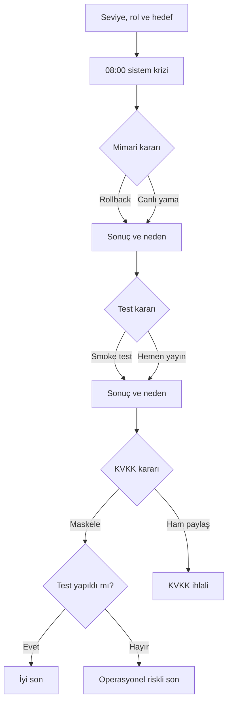

# SE Primer — Ürün Spesifikasyonu

## Problem

Yazılım mühendisliği öğrencileri mimari, test ve veri güvenliği kavramlarını çoğunlukla bağlamdan kopuk tanımlarla öğrenmektedir. SE Primer, öğrenciyi gerçekçi bir üretim krizi içine koyarak verdiği kararların teknik ve etik sonuçlarını görünür kılan, mobil uyumlu bir karar oyunudur.

## Hedef kullanıcı ve amaç

- Yazılım mühendisliğine yeni başlayan veya deneyimli öğrenciler.
- Backend, frontend, test ve DevOps rollerine ilgi duyan kullanıcılar.
- Mimari karar, test stratejisi veya güvenlik/KVKK öğrenmek isteyenler.

## Kapsam

- Girişte seviye, rol ve öğrenme hedefi soruları.
- Bir sağlık/randevu sistemi senaryosu.
- Mimari, test ve KVKK hakkında üç karar.
- Her seçimden sonra “ne oldu?” ve “neden oldu?” açıklaması.
- En az iki farklı sonuç.
- Cevabı söylemeyen, Sokratik soru üslubunda tutor ipuçları.
- Telefon ekranında baştan sona oynanabilen web uygulaması.

## Kapsam dışı

- Kullanıcı hesabı ve oturum açma.
- İkinci bir vaka veya bölüm.
- Gerçek hasta verileri ve gerçek hastane entegrasyonu.
- Native iOS/Android uygulaması.

## Kabul örnekleri

1. **Kişiselleştirme:** Kullanıcı seviye, rol ve hedef seçmeden “Vakayı başlat” dediğinde uygulama ilerlememelidir.
2. **Başlangıç seviyesi:** “Yeni başladım” seçen kullanıcı vakaya girdiğinde her karar ekranında kısa ve anlaşılır bir tutor ipucu görmelidir.
3. **Teknik sonuç:** Kullanıcı herhangi bir seçeneği işaretlediğinde bir sonraki karardan önce seçimin teknik sonucu ve nedeni görünmelidir.
4. **Güvenli son:** Kullanıcı kısa test çalıştırıp kişisel verileri maskelediğinde “Sistem ayakta, veri güvende” sonucuna ulaşmalıdır.
5. **KVKK ihlali:** Kullanıcı ham logları ekiple paylaştığında diğer kararlarından bağımsız olarak KVKK ihlali sonucu gösterilmelidir.

## Akış şeması

## Tutor davranış sözleşmesi

Tutor doğru seçeneği adlandırmaz, seçeneklerden birini önermemeli ve öğrencinin yerine karar vermemelidir. En fazla iki cümleyle öğrencinin seviyesine ve seçtiği hedefe uygun bir soru sorar. İpuçları geri döndürülebilirlik, risk, doğrulama ve veri minimizasyonu kavramlarını düşündürür.
